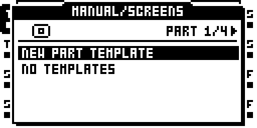
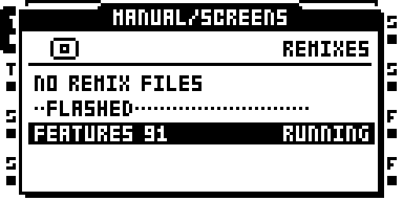
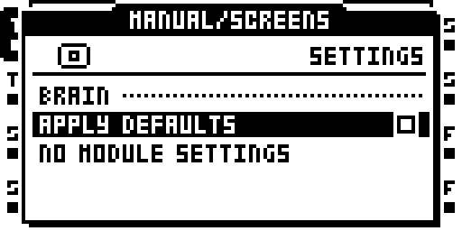
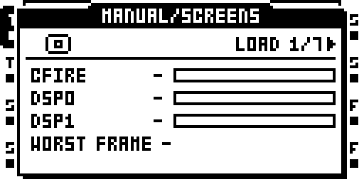
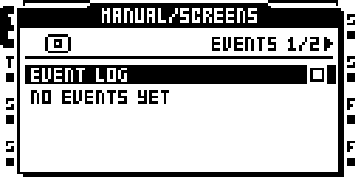
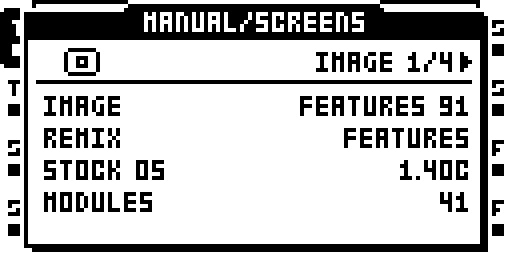

# BRAIN


*BRAIN in the main menu*

BRAIN is the on-unit menu for shared settings, defaults, templates,
performance information, logs, and remix switching. Open it from the MAIN
MENU: select **PROJ**, then **BRAIN**. Use **UP** and **DOWN** to move
through the list, **YES** to open or change the selected item, and **NO** to
return to the previous screen.

The list contains **TEMPLATES**, **REMIXES**, **SETTINGS**,
**PERFORMANCE**, **LOG**, and **ABOUT**.

The current remix-switch persistence path has emulator coverage; its MKII
hardware retest remains open.

## Templates



*BRAIN: Templates*

A template stores a reusable setup. Use **LEFT / RIGHT** to choose the
**PART**, **FX**, **MIDI**, or **PROJECT** tab.

1. Select **NEW** and press **YES** to create a template.
2. Enter a name and confirm with **YES**.
3. Select the saved template to open its actions and values.
4. Choose **APPLY TO…** to apply it, or **SET AS DEFAULT** to use it as a
   starting point. **CLEAR DEFAULT** removes that assignment.

The template screen also provides **SAVE**, **RENAME**, and **DELETE**.

- PART templates hold a whole Part, applied by section and track: FX, LFO,
  INPUT SRC, MIDI TRACKS, SCENES, MACHINES.
- FX templates store an effect page; applying one to a different effect
  replaces that effect. MIDI templates store a MIDI track's pages.
- PROJECT templates cover the stock PROJECT / CONTROL / MIDI screens. SET AS
  DEFAULT on one makes it the settings of every new project.

PART templates leave the project's sample slots, AMP pages, FLEX and STATIC
SRC pages, and levels unchanged. Applying a PART template lets you choose
the whole Part, a section across tracks, or a source and destination track.
A PART default supplies Part Clear and the Parts of a new project.

Use **LEFT / RIGHT** or the encoder to edit values. **NO** returns to the
previous screen; unsaved edits prompt **SAVE CHANGES?**. A name already in
use is refused.

### Page Shortcut

A page shortcut saves and loads the page in front of you as a template:
hold a page key (SRC, AMP, LFO, FX1, FX2) and press FUNC. The list that
opens has SAVE FX DEFAULT, CLEAR FX DEFAULT, SAVE TEMPLATE, LOAD TEMPLATE,
DELETE TEMPLATE (plus NAME KNOB on a MIDI track). On an MKII, FUNC + a push
of the LEVEL encoder opens TOOLS > LOAD.

**SAVE FX DEFAULT** stores the current FX page as the default for that
effect when it is newly selected. **CLEAR FX DEFAULT** removes the stored
default. **SAVE PROJECT** updates its recovery copy.

On a MIDI track, **NAME KNOB** gives each of the ten assignable CCs a label
of up to four characters on CTRL1 and CTRL2. An empty name clears it.

## Switch Remixes



*BRAIN: Switch remixes*

Every `.RMX` file in `/BRAIN/REMIXES/` on the CF card is listed in name
order; the one whose name matches the running image (case and
spaces ignored) has RUNNING at the right. YES on one asks `BOOT <NAME>?` and
boots it without writing the flash. The choice is saved in BRAIN/card.work
and restored at the next reboot, before the project loads. After a switch,
a FLASHED separator shows the installed image; select its name to return
to it and clear the saved choice.

To bypass the selection for one boot, hold FUNC at power-on and choose
EXIT in the stock STARTUP MENU, or remove the card. This new persistence
path has port coverage; its MKII hardware retest remains open.

Making `.RMX` files (an image is a whole OS: stock 1.40C with one remix's
modules built in):

```bash
make image REMIX=<name> BUILD=<nn>      # writes the .RMX beside the .bin
make rmx REMIX=<name>                   # the same, any remix
make rmx-stock                          # -> out/STOCK 1.40C.RMX
```

Copy the `.RMX` files to `/BRAIN/REMIXES/` on the card. Delete any Mac
`._<name>` files first, or they are listed too. Stock 1.40C itself is a
valid switch target. A switch stops playback, syncs the project (as OS
UPGRADE does), loads and resets.

## Settings



*BRAIN: Settings*

Settings are grouped by module. Press **YES** to cycle through a value's
options. **LEFT / RIGHT** decrease or increase it, stopping at the ends.
A value that takes effect at the next boot ends in `*`, with `* AT NEXT
BOOT` under the list.

**APPLY DFLTS** is on by default. Turn it off to use the image's effect
defaults. Settings persist to `BRAIN/card.work`. The MIDI and event logging
switches are described under Logs.

## Performance Views



*BRAIN: Performance views*

Use **LEFT / RIGHT** to change tabs and **UP / DOWN** to scroll. Values
refresh every half second.

| Tab | What it shows |
|---|---|
| LOAD | Processor and DSP activity; WORST FRAME is the longest frame since opening. |
| CPU | Processor time used by each task, with FRAME IRQ first. |
| DSP | Processing cost per effect, plus system activity on each DSP core. |
| MEM | Reserved memory, FLEX use, recorder memory, and remaining audio pages. |
| CARD | Read and write counts, transferred data, and slowest command. |
| MIDI | Message rate and counts for each message type. |
| USB | Audio underruns and overruns, and dropped MIDI output messages. |

DSP measurements require LOAD METER. Without it, the bars stay empty and
the DSP tab explains why. USB reports **NOT IN THIS IMAGE** when unavailable.

## Logs



*BRAIN: Logs*

Use **LEFT / RIGHT** to switch between **EVENTS** and **MIDI**.

**EVENTS** holds the latest 40 events, newest first: FRAME OVER, CPU FULL,
and CARD SLOW. Each entry includes the uptime when it occurred. Turn off
**EVENT LOG** to stop recording events.

**MIDI** shows the latest 24 decoded messages. **MIDI LOG** controls the
debug recording. **WRITE DEBUG LOG** saves the last 256 messages to
`/BRAIN/debug.txt`, excluding clock and active sensing. Both logging
switches are on by default.

## About This Image



*BRAIN: About this image*

Use **LEFT / RIGHT** to change tabs.

| Tab | Information |
|---|---|
| IMAGE | Image and remix name, stock OS version, and module count. |
| CARD | Whether BRAIN settings loaded, used the saved fallback, or were damaged; file size and record counts. |
| PROJECT | Whether the project was saved with this image, has changed effects, has no saved record, or has damaged BRAIN files. |
| MODULES | Module names and their authors. |

## BRAIN Files on the Card

| File or location | Contents |
|---|---|
| `BRAIN/card.work`, `BRAIN/card.strd` at the card root | card-scope settings; the `.strd` is the card-layer defaults, copied at SAVE PROJECT |
| `<set>/<project>/brain.work`, `brain.strd` | project-scope settings; the project record |
| template records in `BRAIN/card.work` | saved templates and card-wide defaults; standalone template import/export is not implemented |

The pair rule: `.work` is the working copy, `.strd` the last saved. A
damaged `.work` falls back to its `.strd`; a damaged pair falls back to the
image's defaults, and nothing is overwritten.

At project load and power-up, effects start with the image's defaults,
then use valid saved defaults from the card. **SAVE FX DEFAULT** stores the
current FX page. **SAVE PROJECT** updates the saved recovery copy. BRAIN
creates its folder and working file when needed.

## Advanced Reference

For editing defaults from a computer and the full card-file format, see the
[BRAIN module documentation](https://github.com/sambanks/octabam/blob/main/modules/brain/README.md).
