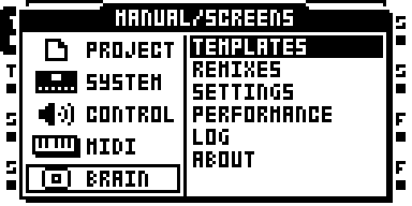

# Octabam Core



*BRAIN in the main menu, added by Octabam Core*

A remix of Octatrack OS 1.40C, built from your own copy of it, that adds the
core modules and changes no effect: all 14 stock effects and both effect
menus stay as stock has them, with stock LO-FI's AMF knob fixed (the LOFI AMF
FIX module). The other official remixes add effects to this set:
[Octabam Inserts](remix-inserts.md) (effects that run on any track) and
[Octabam Bus](remix-bus.md) (a delay and reverb bus).

## Included Features

- [BRAIN](brain.md): templates, settings, defaults, and remix switching.
- [KITS](reference/modules/kits.md): save and recall a Kit for each pattern.
- [Page 2 locks](reference/modules/plocks-p2.md) and
  [scene locks](reference/modules/scenes-p2.md): control both effect pages.
- [MIDI scenes](reference/modules/midi-scenes.md), CC mapping, and CC feedback.
- [USB](reference/modules/usb.md): MIDI input and output, plus MAIN and CUE audio to a computer.
- Recorder, sequencing, mute, and storage fixes listed below.

## Module List

Every module in the image, credited to its author:

??? note "Full module list and authors"

    --8<-- "reference/_remix-octabam-core.md"

USB combines MIDI, audio output, audio input and the input crossbar in one
module. In this first merge, LAYOUT and INPUTS are build settings: changing
them requires rebuilding the image. On-device USB configuration is planned
but is not implemented in this version.

## Memory Use

| Resource | Stock OS | Octabam Core |
|---|---|---|
| Sample and recorder memory | 14,602 pages | 12,895 pages (platform reserve) |
| Free DSP words | — | 0. LOAD METER does not fit, so BRAIN has no LOAD view DSP rows. |

## Where It Has Run

Port gates only: `make check REMIX=octabam-core` and the reach round. Not on
a unit.

## Build and Install

The [build and flash guide](build-flash.md) has every step, from what to
install to the way back to stock. For this remix:

1. **Build.** Pick a build number; it becomes the OS version the unit shows.

   ```bash
   make image REMIX=octabam-core BUILD=91
   ```

2. **Back up the card.** KITS writes `kits.work` into each project it loads.
3. Follow [Build and flash](build-flash.md) to install the image and confirm
   that SYSTEM STATUS → OS VERSION reads `OCTABAM91`.
4. To restore stock OS, follow [Safety and recovery](safety.md).

If the unit misbehaves, the failure register lists what has gone wrong and
why: https://github.com/sambanks/octabam/blob/main/docs/contributing/FAILURE_MODES.md
